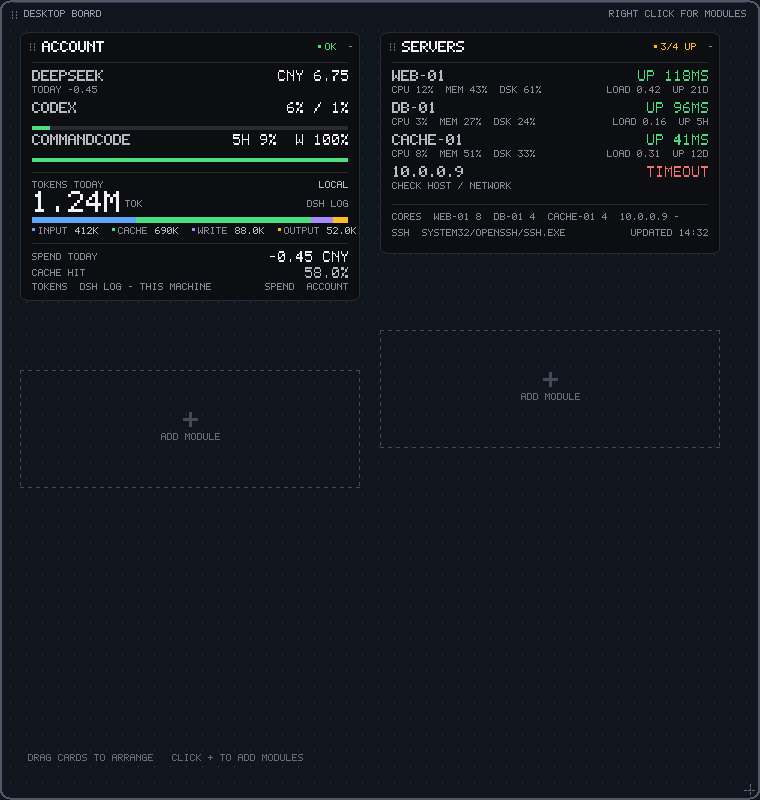
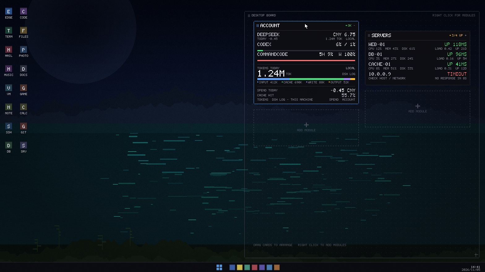

# Desktop Board（desk.exe）

[](https://github.com/kkiwkK1/desk/actions/workflows/windows.yml)

> 一块常驻桌面层的**洞洞板**：一个进程、一块板、若干可自由摆放的模块卡片。
> 当前模块：**Account**（CommandCode 多账号 5h/周/月额度 + 沙箱配额、Codex 5h/周、
> 本机 token；DeepSeek 余额 opt-in）、
> **Server Status**（SSH 服务器状态）和 **PowerShell**（常驻 pwsh 控制台）。
> 1280×1310 面板约 **29 MB 工作集、空闲 0% CPU、不抢焦点、始终置底**
> （PS 卡另带一个常驻 pwsh 子进程，见下文）。



## 它是什么

- **一块板**：首次运行占据**工作区右侧 1280×1310**（本机 2560×1440 的右半屏，
  位于 (1280,0)；96 DPI 名义尺寸、按 DPI 缩放，宽度不超过工作区一半、高度不超过
  工作区），半透明点阵玻璃，可拖动、可缩放，始终压在普通窗口之下。放不下卡片时
  板会找**面积最小**的可行尺寸（宽度按 8px 步长扫到右半屏上限；每个宽度把高度
  按 8px 向上采样、再逐像素细化出最小可行高度，不假设"更高就更容易放下"），
  候选贴工作区右边缘 —— 即使板原来在左侧，需要增长时也会回到右半屏，不会超出
  工作区。
- **多张卡**：每个模块是一张独立卡片，拖动标题条自由摆放；拖动时卡片跟手并夹在
  板内，8px 吸附；松手落到最近合法空位（与别的卡至少留 12px），完全没有空位时
  卡片回到原位并给出提示。
- **内联详情**：点卡片标题条右侧的 `+`/`-` 就地展开，不再有第二个弹窗。
- **可增删**：右键板标题条或托盘 → Add module / Tidy board / Refresh all /
  Fit cards (collapse details) / Reset to right standard panel /
  Restore previous layout / Show grid / Start with Windows / Exit；
  卡片菜单里有模块设置、Details / Refresh / Remove card。
- **不整窗穿透**：卡片和板面控件始终接收鼠标；**没有卡片的空白点**交给桌面，
  桌面图标照常可点。`board.solid=1` 可以改成整块板都接收点击。
- **置底不抢焦点**：点击普通卡片不会改变当前前台窗口；只有 POWERSHELL 卡
  （需要键盘）会在点中时短暂拿到焦点，板仍然贴底；菜单/设置输入框只在自己的
  窗口里取焦点。
- **一套视觉**：板面/卡片/行/详情全部由 `src/widget/skin.*` 的令牌和原语
  绘制；板面 2px 边框 + 10px 像素圆角，卡片 1px + 6px，新增模块自动融入。
- **拖动节拍**：高精度时钟按 60 fps 调度，不再被 15.6ms 系统 tick 压到约 32 fps；
  松手落盘在后台线程，不阻塞 UI。

整屏设计稿（壁纸上的比例参考；实际边框/圆角以当前渲染为准）：



## 产物

| 产物 | 说明 |
|---|---|
| `desk.exe` | 洞洞板 + Account / Servers / PowerShell 卡片 |
| `srvctl.exe` | 命令行搭档：status / exec / ssh / hosts / doctor |
| `archive/` | 旧 aimeter/server/sshpad/clock、AI Mini、旧 host 框架和旧 exe；只作参考，不再构建 |

## 快速开始

```bat
build.bat
powershell -ExecutionPolicy Bypass -File tools\sign-local.ps1 -Path build\bin\desk.exe
build\bin\desk.exe
```

如果工程目录被设置为 Windows 低完整性级别，从这里启动的 `desk.exe` 及其
PowerShell 也会受到限制，可能无法写入用户目录（例如 Pi 的 `trust.json.lock`）。
构建后可在**普通 PowerShell 窗口**中执行下面的命令，将程序安装到当前用户目录：

```powershell
powershell -ExecutionPolicy Bypass -File .\tools\install-desk.ps1
```

发布产物是已签名的 `build\bin\desk.exe`；当前安装的 760×800 实例不会被
构建或测试改动，安装只在准备好时手动执行上面的脚本。

退出旧的桌面板后，从 `%LOCALAPPDATA%\Programs\Desktop Desk\desk.exe` 启动。
脚本首次安装时复制现有配置，更新时保留目标目录中的配置；它不会更改启动项。
如果已启用开机启动，请在新桌面板的菜单中先关闭、再开启 **Start with Windows**，
以更新启动路径。可在卡片中运行 `whoami /groups | findstr /i "S-1-16-"`，
正常用户会话通常应显示 `S-1-16-8192`（Medium）。

- 第一次运行会创建 `build\bin\desk.ini`，把板子按 1280×1310 贴在右上角，
  并移除旧的 `AiMeter` / `Server Status` / `SSH Pad` 自启项、设置
  `Desktop Desk` 自启。
- 右键**板标题条**（顶部 `DESKTOP BOARD` 那一行）或托盘图标打开板菜单。
- 右键**卡片标题条**打开卡片菜单。

## 操作

| 操作 | 说明 |
|---|---|
| 拖卡片标题条 | 移动卡片（夹在板内、8px 吸附）；松手落最近合法空位，没有空位则回到原位并提示；标题条右侧 28px 是 `+`/`-` 展开按钮，不参与拖动 |
| 拖动中按 Alt+Tab 等丢失鼠标捕获 | 卡片回到拾起它的位置 |
| 拖板标题条 | 移动整块板（限制在工作区），松手按当前工作区重新适配 |
| 拖板右下角 | 缩放板；最小 400×420，最大当前显示器工作区；卡片放不下时拒绝缩小并提示 |
| 左键卡片标题条右侧 `+`/`-` | 展开/收起该卡片详情（整板重新规划） |
| 左键 PS 卡命令行区域 | 把键盘交给这张卡，接着就能直接打字（光标闪在输入行） |
| 右键卡片 | 模块菜单（`Type here` / Settings 等）、Details、Refresh、Remove card |
| 右键板标题条 / 托盘 | Add module、Tidy board、Refresh all、Fit cards (collapse details)、Reset to right standard panel、Restore previous layout、Show grid、Empty area passes clicks、Start with Windows、Exit |
| 左键虚线 `ADD MODULE` 槽 | 打开同一个板菜单 |
| `Ctrl+Alt+W` | 打开板菜单 |
| `Ctrl+Alt+R` | 刷新所有卡片 |
| `Ctrl+Alt+D` | 展开/收起所有可展开的卡片 |
| `Ctrl+Alt+Q` | 退出 |
| 托盘双击 | 同 `Ctrl+Alt+D` |

卡片位置、展开状态、板的位置和尺寸都存在 `desk.ini`；下次启动原样恢复。

## 当前模块

### Account（AiMeter）

| 数据 | 来源 | 状态 |
|---|---|---|
| CommandCode 多账号 5h / 周额度、月余额、沙箱分钟 | `GET api.commandcode.ai/alpha/billing/credits`（每账号一次） | ✅ 自动导入 DSH refs 的 `COMMANDCODE_API_KEY[_2...]` |
| Codex / ChatGPT Plus 5h / 周额度 | 本地 `~/.codex/sessions/**/rollout-*.jsonl` 的 `rate_limits` | ✅ 完全离线 |
| 本机 DSH token（Input/Output/Cache） | `~/.dsh/storages/session_projcache` | ✅ 标成 `LOCAL` |
| DeepSeek 余额 / 今日消耗 | `GET api.deepseek.com/user/balance` + 本机快照 | 默认隐藏；`aimeter.ini` 设 `show_deepseek=1` 恢复 |

- 刷新 300s；2 个账号时收起高 144px、展开高 456px；每条数据带 as-of，超过 600s 标 `STALE`。
- 详情：每账号重置倒计时、月余额（可配 `monthly_limit` 显示百分比）、sandbox 用量、
  来源、最近 7 天周额度使用率柱状图；缺数据的日期留空。
- 账号配置在 `aimeter.ini`：`accounts=N`、`account.<i>.label/keyref/source/monthly_limit`；
  第一次运行会自动导入 DSH 凭据里的两个 CommandCode ref 并写回（幂等）。
- key 只在内存中传给 WinHTTP；来源可以是 DSH ref（`source=dsh`）或 Windows 凭据管理器
  `AiMeter/CommandCode/<label>`（`source=credman`），不落明文文件。
- 详情里的 token 只统计**本机 DSH**，界面标 `LOCAL`，不和账户余额混算。

### Assistant（M1）

- `Ctrl+Alt+A` 唤出/收起：板临时抬前并聚焦 ASSISTANT 卡，失焦或再按一次回到底层。
- 输入问题回车发送，中文流式回答；`Esc` 取消；页脚显示来源（`SRC ...`）或 `NO CITATION`。
- 上下文来自 DSH 工作区与 `session_projcache` 的最近结论、记忆事实；`pi --mode rpc`
  在第一次提问时才启动，空闲 10 分钟自动退出（下次提问重启并续会话）。
- `记住：…` 写入长期记忆，`忘掉：…` 软删；回答与记忆都可追溯来源，密钥/凭据路径拒绝入库。
- 配置与数据（配置目录）：`assistant.ini`、`persona.md`、`assistant-episodes.jsonl`、
  `assistant-facts.jsonl`、`assistant-cost.ini`、`assistant-send.log`、`pi-sessions/`。
- 工具只读（`read,grep,find,ls`）；真实网络问答需要在正常会话验证（DSH 沙箱内 pi 起不来）。

### Memory

- Standard 卡：列出长期事实（kind / text / 来源 / 年龄），点击选中；菜单 Pin/Unpin、Delete、Refresh。

### Servers（Server Status）

- 每台一行：在线状态 + 往返耗时，CPU / 内存 / 根分区 / 负载 / uptime。
- 通过本机 OpenSSH 和已有 key 读远端 `/proc`、`df`，不装 agent。
- 刷新 30s；最多 8 台；每台一次只读探测，单台 8s 超时，互不拖累。
- 高度：收起 176 / 展开 224（8 台收起 304 / 展开 352；无主机时 112/128）。
- 卡片菜单：`SSH Hosts...`，写回 `server.ini` 的 `hosts=`；
  `srvctl status` / `srvctl hosts` 读同一份配置，改完立即生效。
- 展开详情补充失败错误、`CORES`、SSH 客户端路径和 `UPDATED`，不重复行内指标。

状态值：`UP 120MS` / `TIMEOUT` / `AUTH` / `DNS` / `REFUSED` / `HOSTKEY` /
`NO SSH` / `NO DATA`。绿色 < 75%，黄色 ≥ 75%，红色 ≥ 90%。

详细配置、探测脚本和排错见 [docs/server.md](docs/server.md)。

### PowerShell（真终端）

一张常驻的 pwsh 卡，底下是 **ConPTY 伪控制台**：shell 以为自己在一个真终端里，所以
PSReadLine、`vim`、`less`、`pi agent` 这类全屏 TUI 都能正常工作。点一下卡片正文就能
直接打字，空转时 0 轮询。

- shell 解析顺序：`ps.ini` 的 `shell=` → `%PWSH_EXE%` → PATH 上的 `pwsh`
  → `%ProgramFiles%\PowerShell\7\pwsh.exe` → `L:\powershell\pwsh.exe`
  → 5.1 的 `System32\WindowsPowerShell\v1.0\powershell.exe`。
- 以 `-NoLogo -NoProfile` 起一个**交互式** shell（不是 `-Command -`），工作目录
  `%USERPROFILE%`。行列固定 **80 × 8（收起）/ 80 × 24（展开）**，格子 7×14 px，
  卡宽 568、卡高 168 / 392；展开/收起会 `ResizePseudoConsole` 通知应用重绘。
- 键盘：`Enter` `Tab` `Esc` 方向键 `Home` `End` `Ins` `Del` `PgUp` `PgDn` `F1-F12`、
  `Ctrl+字母`（`Ctrl+C` 就是中断）、`Alt+前缀` 都按 VT 编码送进 PTY。
- 复制粘贴：**`Ctrl+Shift+C` 复制选中**，`Ctrl+Shift+A` 全选可见区；
  在正文上按住左键拖动即可选中（蓝色高亮，跨行、跨回滚）；`Ctrl+V` 走
  bracketed paste（应用支持时）。
- 回滚：普通终端中滚轮每格翻 3 行，最多保留 **2000 行**；查看历史时新输出不会
  改变当前所看的位置。右侧细条显示位置，点击右下角 `↓ BOTTOM` 回到最新输出。
  Pi 等开启终端鼠标模式的应用会接收滚轮事件，用于滚动其自身界面。Windows ConPTY
  可能隐藏模式声明，Auto 会在滚动时识别此卡 shell 下的 Pi CLI，按默认全屏模式
  转发；若 Pi 配置为 regular 模式，或其他应用无法自动识别，可在卡片菜单中选择
  `Wheel: Terminal history` 或 `Wheel: Application (SGR)`。用完手动应用模式后可切回 Auto。
- 颜色：ANSI 16 色 + 256 色 + 真彩色、粗体/暗淡/下划线/反显；宽字符占两格。
- 历史：卡片用自己的 `ps-history.txt`（和 `ps.ini` 同目录），不写
  `%APPDATA%\...\ConsoleHost_history.txt` —— 既不会污染你的终端历史，也不会因为
  该目录不可写而每次启动都刷一行 `Access is denied`。
- 卡片菜单：`Copy`、`Clear scrollback`、`Restart shell`、`Type here`、
  `Run system test`（PS 版本 / 主机名 / 已开机小时 / C: 剩余 / 当前目录）。
- 焦点：**只有点中这张卡，板才拿键盘**；其余位置照旧不抢焦点。拿到键盘后板仍贴底。

状态值：`PWSH 7.6`（运行中，绿）/ `NO SHELL`（找不到或启动失败，红）/
`EXITED`（shell 已退出，红，`Restart shell` 恢复）/ `↓n`（正在看历史，黄）。

## 配置

配置文件都在 exe 同目录；目录不可写时回退到 `%APPDATA%\Desktop Desk`。

`desk.ini`（UTF-16 key=value；下面是空配置首次运行在本机的样子，
Servers 有主机时卡片更高，PowerShell 会落到再下一行）：

```ini
board.x=1280          rem 本机工作区 2560x1392，面板贴右上
board.y=0
board.w=1280
board.h=1310
board.version=2       rem 几何版本；旧配置先备份成 desk.ini.pre-v2.bak 再迁移
board.grid=1          rem 1 = 显示点阵
board.solid=0         rem 1 = 整块板接收点击（默认空白点交给桌面）
card.account.x=14     rem 首次运行按内容高度摆成参考书架，之后以实际保存值为准
card.account.y=32
card.account.visible=1
card.account.expanded=0
card.servers.x=366
card.servers.y=32
card.servers.visible=1
card.servers.expanded=0
card.ps.x=14
card.ps.y=192         rem 空配置示例（8px 网格对齐）；Servers 有 4 台主机时会到下一行的 y=224
card.ps.visible=1
card.ps.expanded=0
```

模块自己的数据仍在原来的文件里：`aimeter.ini`（余额快照、token 快照）、
`server.ini`（hosts/ssh/key/timeout）、`ps.ini`（`shell=` 显式路径、
`autostart=0` 推迟到第一条命令才拉起 shell）。旧文件不需要迁移。

**不要和新旧组件同时运行**：新旧都会更新同一份 `aimeter.ini` 快照；首次运行
会清掉旧的失效自启项，并写 `Desktop Desk`。

## 框架与组件

`src/widget/` 是可单独构建的 Windows 桌面组件框架；`src/panels/` 和
`src/data/` 是使用框架的上层组件与数据源。应用通过源码工厂注册组件，
当前不提供 DLL 动态插件或热加载。

```bat
build.bat framework   rem 只构建 build\sdk 中的框架头文件和静态库
build.bat example     rem 只使用 SDK 构建独立示例
```

独立接入方式、接口及线程约定见 [框架文档](docs/framework.md)，示例见
[minimal-board](examples/minimal-board)。现有 `desk.exe` 使用自己的注册表、配置和
组件，不会因为独立应用使用框架而被捆绑进去。

需要自己控制生命周期时用 `wg::BoardHost`（`widget/host.h`：Start/Run/Quit、
Metrics、PlanPreview、程序化卡片操作、`BoardEvent` 事件流）；显示环境通过
`widget/display.h` 的 `DisplaySource` 注入（系统实现或脚本实现），日志通过
`widget/diag.h` 的线程安全 sink 输出。

## 新增一个模块

```bat
powershell -ExecutionPolicy Bypass -File tools\new-panel.ps1 -Name weather -Title WEATHER
rem 编辑 src\panels\weather\weather.cpp 的 RefreshData / PaintBodyOf
rem 在 src\apps\desk\main.cpp 中加一行：
rem   modules.push_back(CreateWeatherModule());
build.bat
```

模块契约只有六个函数：

```cpp
struct WeatherData { std::vector<wg::Row> rows; };

class WeatherModule : public wg::ModuleT<WeatherData> {
public:
    wg::ModuleSpec Describe() const override {
        wg::ModuleSpec spec;
        spec.id = L"weather";
        spec.title = L"WEATHER";
        spec.sizePreset = wg::SizePreset::Standard;
        spec.refreshSeconds = 600;
        return spec;
    }
protected:
    void LoadData(WeatherData&) override { ... }
    void RefreshData(WeatherData& data) override { ... }   // worker 线程，可阻塞
    int  BodyHeightOf(const WeatherData& data) const override {
        return wg::skin::RowsHeight((int)data.rows.size());
    }
    void PaintBodyOf(const WeatherData& data, wg::Canvas& c, const wg::Rect& body) override {
        wg::skin::Rows(c, body, data.rows, theme_);
    }
private:
    wg::Theme theme_;
};
```

- `RefreshData` 写 staging，`PaintBodyOf` 读 shown；两者可以并发执行。
  快照之外的共享成员需要组件自行同步。
- 卡片从框架预设选择大小：`Compact` 256 / `Standard` 340 /
  `Wide` 568 / `Full` = 面板卡片区宽度（本机 1252）；模块只声明**内容高度**
  （`BodyHeightOf`），框架加 48px 外框、按 8px 向上取整并校验范围。模块只画
  body，不画外框、不建窗口。各档高度范围见 [框架文档](docs/framework.md)。
- 新模块自动出现在 **Add module** 菜单里；位置/展开状态由 Board 持久化。
- 完整契约、视觉规范和测试见 [docs/desk.md](docs/desk.md)。

## srvctl（命令行）

`srvctl.exe` 保持独立：脚本、CI、一次性远程命令用它，桌面卡片回答“现在怎么样”。
两者共用 `src/data/server/providers.cpp` 和 `server.ini`，状态码/超时/探测脚本
完全一致。

```bat
build\bin\srvctl.exe status
build\bin\srvctl.exe exec web-01 -- uptime
build\bin\srvctl.exe hosts add db-01
build\bin\srvctl.exe doctor
```

完整命令、JSON schema 和退出码见 [docs/cli.md](docs/cli.md)。

## 归档

旧的 aimeter / server / sshpad / clock、旧 `Widget/Host` 框架、AI Mini 实验、旧测试/
脚手架和旧 exe 已移到 `archive/`，不参与 `build.bat`；清单和恢复方法见
[archive/README.md](archive/README.md)。

## 分支、CI 与贡献

- `main` = **已验收阶段基线**（可回滚，未验证能力保留限制），`dev` = **下一阶段开发候选**。
  PR #1 已合入 CardSpec 界面/离线阶段；真实 HTTPS 正向仍未验证，不等于完整 M2 已完成。
- 日常开发在 `dev`；开发完成后开 PR，CI **Windows regression** 变绿且维护者
  显式记录人工验收后，才由维护者以 **merge commit** 合入 `main`
  （禁 squash / rebase，合并后 `dev` 不删除）。
- 完整流程、验收边界与分支保护设置见 [CONTRIBUTING.md](CONTRIBUTING.md)；
  构建/测试/签名、写作用域与凭据约定见 [AGENTS.md](AGENTS.md)。
- CI 全离线：不 live-probe、不连真实 Pi/SSH、不使用真实凭据，也不上传产物。

## 构建与测试

需要 **MinGW-w64 GCC**（开发时 WinLibs GCC 16.2.0，UCRT + POSIX 线程）和
Windows 10/11 x64；CI 用 `windows-latest` + MSYS2 UCRT64，跑同一套入口
（`tools\build-lock.ps1 -Target test`）。

```bat
build.bat            rem 框架 + desk.exe + srvctl.exe
build.bat test       rem 额外跑无窗口测试，产出 build\preview.bmp / desk-board-preview.bmp 等
```

`build.bat test` 现在也会构建并运行框架级的 `board-plan-test`、
`size-presets-test`、`board-grow-test`（最小面积增长、右对齐、非单调
高度反例）、`board-composition-test`（1280×1310 面板上的整板组合：预设尺寸、
8px 网格、12px 间距、`Full=1252`、落点与新增卡片）、`store-test`（精确快照
落盘、删除键不复活）、`module-body-test`（`ClampBodyHeight` 夹取规则，
`tests/module_body.cpp`）、`display-source-test`（系统/`ScriptedDisplaySource`，
`tests/display_source.cpp`）、`diag-test`（线程安全日志，`tests/diag.cpp`）和
`board-host-test`（`BoardHost` 生命周期、事件顺序、PlanPreview、脚本显示源下的
适配/恢复，`tests/board_host.cpp`）。`display.cpp` / `diag.cpp` 是新的框架单元，
`BoardHost` 实现在 `board.cpp`。

GUI/验收用 `tools\desk-testrun.ps1`、`tools\desk-ui-test.ps1`、
`tools\desk-perf.ps1`：它们把 exe 复制到 `build\testrun\` 并用
`DESK_TEST_INSTANCE` 起隔离实例，不碰正在运行的 desk，也不改 HKCU Run。
显示/DPI 变化用框架的 `DisplaySource` 模拟：`DESK_TEST_DISPLAY_FILE`
（`work=`/`dpi=`/`rect=` ASCII 脚本）会让板子用
`ScriptedDisplaySource`（每次查询重读；缺文件保留上次有效值）。程序化驱动用
`BoardHost::ReadaptToDisplay()` / `ApplySuggestedRect()`；现有 harness 用的
`WM_APP+9`/`WM_APP+10` 是兼容 shim。冻结构建验收：**17 个场景 / 437 项检查 /
0 失败**。

- 所有中间文件和产物都在 `build\` 下，故意使用相对路径：MinGW 汇编器无法处理
  非 ASCII 路径（例如中文用户名/目录）。
- `build.bat test` 在跑测试前用 `tools\sign-local.ps1` 给测试 exe 签名；如果
  证书无法创建，脚本会失败，可以先手动运行 `tools\sign-local.ps1`。
- **Windows 11 Smart App Control**：新构建的 exe 会被拦截，运行
  `powershell -ExecutionPolicy Bypass -File tools\sign-local.ps1`
  用当前用户的自签名证书重签即可（无需管理员、不上传；重建后要重签）。

## 性能（本机实测）

同一台 Windows 11 机器，2026-11-07，接口批次后的**冻结构建**，10 s 采样窗口，
取 `build\qa\perf\acceptance-clean`/`acceptance-clean2` 三次采样的中位。
新 = 1280×1310 面板的隔离实例，新 760 = 同一构建按旧尺寸跑。**旧列口径**：
QA 复测时正在运行的 760×800 安装已被关闭，所以旧列是同一工具在 20:28 对未改动
的已安装二进制采的样（不是与新版同一时刻，但同机基线可比）：

| 指标 | 旧 760×800（20:28） | 新 1280×1310 | 新 760×800 |
|---|---|---|---|
| 进程 / 窗口 / 托盘 | 1 / 1 / 1 | 1 / 1 / 1 | 1 / 1 / 1 |
| 空闲工作集 | 29.1 MB | 29.5 MB | 21.4 MB |
| 空闲私有内存 | 7.2 MB | 10.1–10.5 MB | 6.0–6.4 MB |
| 线程 | 9 | 12–13 | 12–13 |
| GDI / USER 对象 | 14 / 16 | 11 / 7 | 11 / 7 |
| 空闲 CPU（10 s） | 0 ms | 0 ms | 0 ms |
| 悬停约 600 次移动 | 31.2 ms（0.31%） | 46.9 ms（0.47%） | 0 ms |
| 拖动约 600 次移动 | 265.6 ms（2.59%） | 531.2 ms（5.2%） | 281.2 ms（2.8%） |
| PS 持续输出 10 s | 未测 | 281.2 ms（2.8%） | — |
| PS 首帧延迟 | — | 35 ms（中位；33–52） | — |

3 次运行范围：悬停 15.6–46.9 ms，拖动中位 531.2（500–609），PS 输出中位 281.2
（172–469），同尺寸拖动中位 281.2（156–406），首帧 33–52 ms。线程数随状态变化
（shell 子进程、刷新 worker、后台保存线程是否活跃）。空闲是事件驱动的（0 CPU）。
本次接口批次没有改动任何逐帧路径；差异属于机器负载波动，空闲 CPU 与几何结果与
上一轮完全一致（fresh 1280×1310@(1280,0)、cannot-fit 952×478=455,056）。统一
收益：一个 UI 线程、一个令牌/字体缓存、一个 WinHTTP/SSL 栈、一个托盘、一个自启
项、一套热键、一张 DIB；拖动卡片只移动板内矩形，不创建/移动 HWND，也不重建 DIB。

## 目录

```
src/apps/desk/main.cpp      注册模块（一行一个）
src/panels/account/         Account 卡片 + 视图
src/panels/servers/         Servers 卡片 + 视图
src/panels/ps/              PowerShell 卡片 + 控制台视图（内联输入）
src/widget/board.*          洞洞板宿主：窗口、调度、拖动、菜单、托盘、键盘焦点、持久化
src/widget/size.h           尺寸预设、MeasureCardSize、超范围报告
src/widget/board_layout.*   单卡纯布局：吸附、避让、命中测试
src/widget/board_plan.*     整板规划：确定性候选顺序、原子失败、可诊断状态
src/widget/board_grow.*     最小面积自动增长：8px 宽度扫描、右对齐、有界
src/widget/host.h           BoardHost 程序化宿主（实现在 board.cpp）
src/widget/display.*        DisplaySource：系统/脚本工作区与 DPI 来源
src/widget/diag.*           线程安全诊断日志
src/widget/skin.*           板面/卡片/行/详情/控制台/Add 槽的视觉令牌
src/widget/module.h         Module / ModuleT<Data> 契约（含键盘钩子）
src/widget/geom.h           Rect
src/widget/appenv.*         配置目录、自启
src/widget/                 其余框架（canvas/cjk/view/layout/store/http/secrets/prompt/proc）
src/data/                   共享数据源（aimeter / server / ps）
src/cli/                    srvctl
archive/                    旧组件/实验/文档/二进制（不参与构建）
.github/workflows/windows.yml Windows 离线回归 CI（required check：Windows regression）
CONTRIBUTING.md             main/dev 流程、PR 与人工验收边界
AGENTS.md                   构建/测试/签名入口、写作用域与凭据约定
tests/board_layout.cpp      布局/裁剪/命中的无窗口测试
tests/board_plan.cpp        整板规划（顺序/证明/原子失败）的无窗口测试
tests/board_grow.cpp        最小面积自动增长（8px 网格、右对齐、有界）
tests/size_presets.cpp      预设表、Auto 兼容与高度范围
tests/board_composition.cpp 1280×1310 面板的整板组合测试
tests/store_tests.cpp       精确快照落盘、删除键不复活
tests/module_body.cpp       body 高度夹取规则（module-body-test）
tests/display_source.cpp    系统/脚本 DisplaySource（display-source-test）
tests/diag.cpp              线程安全日志（diag-test）
tests/board_host.cpp        BoardHost 生命周期/事件/预览（board-host-test）
tests/desk_render.cpp       整板渲染测试（BMP）
tests/ps_tests.cpp          解码/ANSI/切行/行编辑器 + 常驻 shell 端到端测试
tools/new-panel.ps1         新模块脚手架
tools/desk-testrun.ps1      隔离实例场景验收（build\testrun + 证据）
tools/desk-ui-test.ps1      PS 卡 UI 验收（宽度/列数/焦点/滚轮）
tools/desk-perf.ps1         旧/新性能对比（隔离实例 + 只读采样）
tools/bench-desktop.ps1     资源/空闲 CPU 采样
tools/sign-local.ps1        Smart App Control 下的本地签名
docs/desk.md                洞洞板/模块/视觉/配置完整说明
docs/server.md              Servers 卡片与共享探测的排错
docs/cli.md                 srvctl
archive/docs/sshpad.md      SSH Pad（已归档，不构建）
```

## 已知限制

- 本机单显示器。只有面板外框按 DPI 推导（96 DPI 名义尺寸 → 系统 DPI，之后
  跟随当前显示器工作区，宽度不超过工作区一半）；卡片尺寸/字号仍是 96 DPI 基准的
  物理像素，高 DPI 下卡片相对面板显得更小。板的位置/尺寸在 `desk.ini`。
- 空白板面默认把点击交给桌面，所以**板菜单在标题条/托盘/Add 槽上**，不是空白
  处；要整板接收点击把 `board.solid` 设为 1。
- `Restore previous layout` 是**严格恢复**：快照里的面板矩形必须完整放进当前
  工作区、卡片位置必须原样排下，否则不算恢复成功（快照继续保留、当前布局不动，
  提示 `PREVIOUS LAYOUT DOES NOT FIT THIS DISPLAY YET`）。连续多次显示/DPI
  变化只保留**最早**那份快照，后续适配不会覆盖它；小屏启动或临时改 DPI 只适配
  当前显示，原始布局先存进 `saved.*`，换回原显示后可恢复。
- 一个模块类型只放一张卡；卡片宽度由尺寸预设决定，不支持单独拉伸；高度超出
  预设范围时显示 `TOO TALL` 并报告（不悄悄截断内容），比卡片区还高时布局显示
  `NO SPACE`，可收起详情、移除卡片或让面板自动增长。
- `Win+D`（显示桌面）会把板一起隐藏（普通顶层窗口的既有行为）。
- 退出时如果 SSH 探测在飞，最多等一个 8s 探测超时。
- Servers 只支持 Linux 目标（读 `/proc`），最多 8 台；`srvctl` 最多 32 台。
- CommandCode 使用未公开的 `/alpha` 接口，字段变化时该行显示 `NO DATA`。
- PS 卡带着一个常驻子进程 + 一个 conhost：pwsh 7 空闲约 **99 MB 工作集 / 27 线程**
  （5.1 约 72 MB）。想省内存把 `ps.ini` 设 `autostart=0`，第一条命令时才会拉起。
- PS 卡要先点中卡片才收键盘；这一刻板会被激活（仍贴底，不改变前台窗口的可见顺序），
  点别处 / 开菜单即释放。行列固定 80×8 / 80×24，不能像真终端那样任意拉伸；
  字符只有 5×7 像素字体，**只有大写**；不支持把鼠标事件上报给应用（拖选始终是本地
  选中）；回滚 2000 行。
- ConPTY 要求**调用方自己没有控制台**才把客户端挂到伪控制台上。卡片（GUI 进程）
  满足；测试里由 `tests/pty_helper.cpp` 先 `FreeConsole()` 再跑往返。
- 不并入 SSH Pad / Clock / AI Mini；它们已归档在 `archive/`，不再构建；需要时按
  `Module` 契约重新接入。
- Smart App Control 开启时（本机 `VerifiedAndReputablePolicyState=1`），重建的 exe
  要用 `tools\sign-local.ps1` 重签；自签根证书不在信任库里，SAC 仍可能拦住新
  hash。若被拦，见 `docs/desk.md` 的排错一节。
- 新旧组件不要同时运行（共享 `aimeter.ini` 的当日快照）。

## License

[MIT](LICENSE)
